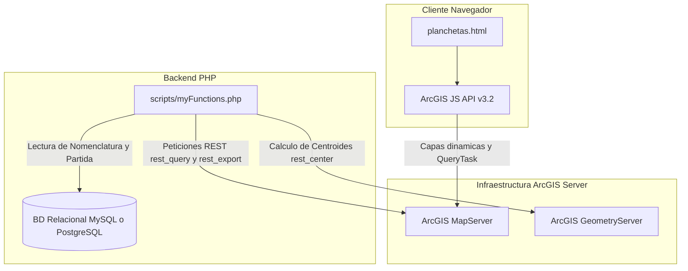

# Análisis de Integración con la Infraestructura ArcGIS

Este documento detalla la arquitectura de integración entre la aplicación de catastros y la infraestructura de GIS basada en **ArcGIS Server**.

---

## 1. Visión General de la Arquitectura

La aplicación interactúa con la infraestructura de ArcGIS mediante un esquema híbrido cliente-servidor a través de la **API REST de ArcGIS Server** (`https://catastro.aref.gob.ar/arcgis/rest/services/`).



---

## 2. Componentes de Integración

### 2.1. Frontend (Capa de Cliente - JavaScript)

El visor gráfico ubicado en [`planchetas.html`](file:///c:/xampp/htdocs/aref/plancheta/planchetas/planchetas.html) gestiona la interacción cartográfica interactiva:

* **Librería de Clientes**: Incorpora **ArcGIS API for JavaScript v3.2** construida sobre Dojo Toolkit.
* **Carga de Capas Dinámicas**:
  ```javascript
  // Inicialización del visor de mapa y capa dinámica
  var initExtent = new esri.geometry.Extent({"xmin":2419515.92,"ymin":3881745.36,"xmax":2893907.07,"ymax":4198006.13,"spatialReference":{"wkid":5344}});
  map = new esri.Map("map", { extent: initExtent, logo: false });

  parcelario = new esri.layers.ArcGISDynamicMapServiceLayer(
      "https://catastro.aref.gob.ar/arcgis/rest/services/PRUEBAS/Plancheta_actual/MapServer",
      { "imageParameters": imageParameters }
  );
  map.addLayers([parcelario]);
  ```
* **Consultas por Nomenclatura (`QueryTask`)**:
  Utiliza `esri.tasks.QueryTask` y `esri.tasks.Query` para consultar las capas según la nomenclatura catastral (Departamento, Sección, Macizo, Chacra, Quinta, Parcela, Partida):
  * **Capa 7**: Parcelas Urbanas.
  * **Capa 4**: Macizos Urbanos.
  * **Capa 8**: Parcelas Rurales.

---

### 2.2. Backend (Capa de Servidor - PHP)

El archivo [`scripts/myFunctions.php`](file:///c:/xampp/htdocs/aref/plancheta/scripts/myFunctions.php) maneja las llamadas en servidor hacia ArcGIS Server mediante funciones HTTP:

1. **`rest_query($srv, $where, $layer)`**:
   Envía solicitudes de consulta a la API REST de ArcGIS (`.../MapServer/{layer}/query?outFields=*&f=json&where=...`) y procesa el resultado en formato JSON.
   
2. **`rest_center($srv, $wkid, $rings)`**:
   Llama al `GeometryServer` (`.../GeometryServer/labelPoints`) para determinar el centroide o punto de etiquetado de la geometría vectorial.

3. **`rest_export($srv, $bbox, $zoom, $size, $dpi, $wkid, $layers, ...)`**:
   Genera imágenes dinámicas estáticas llamando al endpoint `/export` del `MapServer` (`.../MapServer/export?bbox=...&format=JPG&f=json`). Esto permite renderizar planos y mapas estáticos directamente desde PHP.

---

## 3. Vinculación de Datos: Alfa-numérico vs. Espacial

> [!NOTE]
> La aplicación no almacena las geometrías de las parcelas dentro de su base de datos relacional principal. En su lugar, utiliza un modelo federado.

* **Base de Datos Alfa-numérica (MySQL / PostgreSQL)**:
  Contiene los datos del padrón, dominio, propietarios, partidas presupuestarias y desgloses de la nomenclatura catastral (`DTO`, `SEC`, `MZO`, `CHA`, `QTA`, `PAR`, `PARTIDA`).
* **ArcGIS Server / SDE (Base de Datos Espacial)**:
  Almacena las capas vectoriales georreferenciadas con referencia espacial **WKID 5344** (POSGAR 07 / Argentina 4).
* **Mecanismo de Enlace**:
  1. PHP o JS consulta la BD alfa-numérica para obtener los valores catastrales de una parcela o partida.
  2. Con esos datos se formula la cláusula `WHERE` (ej. `DTO = '1' AND SEC = 'A' AND MZO = '12'`).
  3. Se ejecuta la petición HTTP a la API REST de ArcGIS para solicitar la geometría o la extensión visual correspondiente.

---

## 4. Archivos Clave del Código Fuente

* [`configuracion_general.php`](file:///c:/xampp/htdocs/aref/plancheta/configuracion_general.php): Contiene la definición de constantes generales de ArcGIS (ej. `ARCGIS_VERSION`).
* [`planchetas/planchetas.html`](file:///c:/xampp/htdocs/aref/plancheta/planchetas/planchetas.html): Visor de mapa en cliente e integración con la librería JS de Esri/ArcGIS.
* [`scripts/myFunctions.php`](file:///c:/xampp/htdocs/aref/plancheta/scripts/myFunctions.php): Funciones de conexión REST PHP (`rest_query`, `rest_center`, `rest_export`, `mapa_jpg`).
