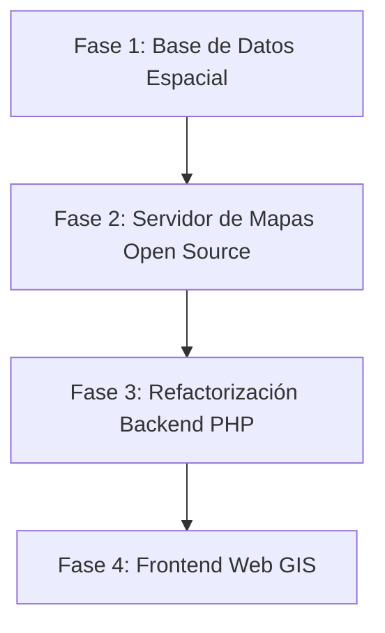

# Plan de Migración a Infraestructura GIS 100% Open Source

Este documento describe la propuesta arquitectónica y la estrategia por fases para reemplazar la infraestructura propietaria basada en **ArcGIS** (ArcGIS Server, Esri JS API 3.2, GeometryServer) por un stack moderno, estándar y **100% Open Source**.

---

## 1. Mapeo de Reemplazo Tecnológico

| Componente Actual (ArcGIS) | Alternativa Open Source Recomendada | Rol / Función en la Nueva Arquitectura |
| :--- | :--- | :--- |
| **ArcGIS Server (MapServer)** | **GeoServer** o **QGIS Server** | Servidor de mapas estándar (OGC WMS para imágenes de mapas, OGC WFS para datos vectoriales). |
| **ArcGIS GeometryServer** | **PostGIS (Funciones nativas en DB)** | Las operaciones geométricas (centroides, bounding boxes, buffers) se realizan directo en SQL (`ST_Centroid`, `ST_Envelope`). |
| **ArcGIS JS API 3.2** | **OpenLayers** (o **Leaflet**) | Visor cartográfico web en cliente, con soporte nativo para proyecciones argentinas (EPSG:5344 / POSGAR 2007). |
| **SDE / ArcGIS Geodatabase** | **PostgreSQL + PostGIS** | Base de datos relacional y espacial unificada. |
| **Formato de intercambio (`f=json`)** | **GeoJSON / Vector Tiles / OGC API** | Formatos estándares abiertos para transferencia de geometrías cliente-servidor. |

---

## 2. Ventajas Clave del Cambio

1. **Eliminación Total de Costos de Licenciamiento**: Sin costos por servidor (ArcGIS Server) ni restricciones por núcleos o usuarios.
2. **Estándares Abiertos (OGC)**: Interoperabilidad garantizada con IDE (Infraestructuras de Datos Espaciales) provinciales y nacionales (IDERA).
3. **Mayor Rendimiento Backend**: Reemplazo de peticiones HTTP lentas a `GeometryServer` por consultas SQL ultra-rápidas en PostGIS.
4. **Sporte Nativo POSGAR 2007 / EPSG:5344**: OpenLayers gestiona de manera transparente y precisa los sistemas de coordenadas oficiales de Argentina.
5. **Modernización Técnica**: Sustitución de librerías legadas (Dojo / Esri JS 3.2 de ~2012) por JavaScript moderno (ES6+, OpenLayers 8+ / Leaflet).

---

## 3. Estrategia de Migración por Fases



### Fase 1: Base de Datos Espacial (PostgreSQL + PostGIS)
- **Acción**: Migrar la cartografía vectorial a tablas con geometría en PostGIS (`geometry(MultiPolygon, 5344)`).
- **Tablas clave**: `parcelas_urbanas`, `parcelas_rurales`, `macizos`, `chacras`, `quintas`, `secciones`.
- **Beneficio**: Las nomenclaturas y geometrías residen en el mismo motor de base de datos o están asociadas de forma nativa por `parcela_id` o nomenclatura catastral.

### Fase 2: Servidor de Mapas (GeoServer / QGIS Server)
- **GeoServer**:
  - Publicación de las tablas de PostGIS como capas **WMS** (para renderizar imágenes de mapa en el visor y reportes) y **WFS** (para descarga o consulta de geometrías).
  - Configuración de estilos visuales con **SLD (Styled Layer Descriptor)** o **CartoCSS**.
- **QGIS Server** *(Alternativa rápida)*:
  - Permite diseñar el mapa directamente en QGIS Desktop y publicarlo tal cual en el servidor con 100% de fidelidad gráfica.

### Fase 3: Refactorización del Backend (PHP)
En [`scripts/myFunctions.php`](file:///c:/xampp/htdocs/aref/plancheta/scripts/myFunctions.php):
1. **Sustituir `rest_query()` por SQL PostGIS**:
   ```php
   // En lugar de file_get_contents(...) a ArcGIS Rest Query:
   $sql = "SELECT ST_AsGeoJSON(geom) as json, ST_XMin(geom) as xmin, ST_XMax(geom) as xmax, 
                  ST_YMin(geom) as ymin, ST_YMax(geom) as ymax
           FROM parcelas_gis 
           WHERE departamento = :dto AND seccion = :sec AND macizo = :mzo";
   ```
2. **Sustituir `rest_export()` por WMS GetMap**:
   ```php
   // Petición OGC WMS estándar a GeoServer para obtener la imagen JPG/PNG
   $wmsUrl = "http://localhost:8080/geoserver/catastro/wms?" . http_build_query([
       'SERVICE' => 'WMS',
       'VERSION' => '1.1.1',
       'REQUEST' => 'GetMap',
       'LAYERS'  => 'catastro:parcelario',
       'BBOX'    => "$xmin,$ymin,$xmax,$ymax",
       'WIDTH'   => 800,
       'HEIGHT'  => 600,
       'SRS'     => 'EPSG:5344',
       'FORMAT'  => 'image/jpeg'
   ]);
   ```

### Fase 4: Reemplazo del Frontend (JS API)
En [`planchetas.html`](file:///c:/xampp/htdocs/aref/plancheta/planchetas/planchetas.html):
1. Sustituir Esri JS API por **OpenLayers**:
   ```html
   <link rel="stylesheet" href="https://cdn.jsdelivr.net/npm/ol@v8.2.0/ol.css">
   <script src="https://cdn.jsdelivr.net/npm/ol@v8.2.0/dist/ol.js"></script>
   <script src="https://cdnjs.cloudflare.com/ajax/libs/proj4js/2.9.0/proj4.js"></script>
   ```
2. Inicializar el mapa con proyección **POSGAR 2007 (EPSG:5344)**:
   ```javascript
   // Registrar EPSG:5344 en proj4
   proj4.defs("EPSG:5344", "+proj=tmerc +lat_0=-90 +lon_0=-60 +k=1 +x_0=2500000 +y_0=0 +ellps=WGS84 +units=m +no_defs");
   ol.proj.proj4.register(proj4);

   var map = new ol.Map({
     target: 'map',
     layers: [
       new ol.layer.Tile({
         source: new ol.source.TileWMS({
           url: 'http://localhost:8080/geoserver/catastro/wms',
           params: {'LAYERS': 'catastro:parcelario', 'TILED': true}
         })
       })
     ],
     view: new ol.View({
       projection: 'EPSG:5344',
       center: [2656711.5, 4039875.7],
       zoom: 12
     })
   });
   ```

---

## 4. Comparativa Arquitectónica

```
[ANTES - ArcGIS Propietario]
Browser (Esri JS 3.2 / Dojo) ──REST──> ArcGIS Server (MapServer / GeometryServer) ──> Geodatabase Esri
PHP Backend ───────────────────REST──> ArcGIS Server (Query / Export)

[DESPUÉS - Open Source]
Browser (OpenLayers / Leaflet) ──WMS/WFS──> GeoServer / QGIS Server ──> PostgreSQL / PostGIS
PHP Backend ─────────────────────PDO/SQL──> PostGIS (Directo / Ultra-rápido)
```
